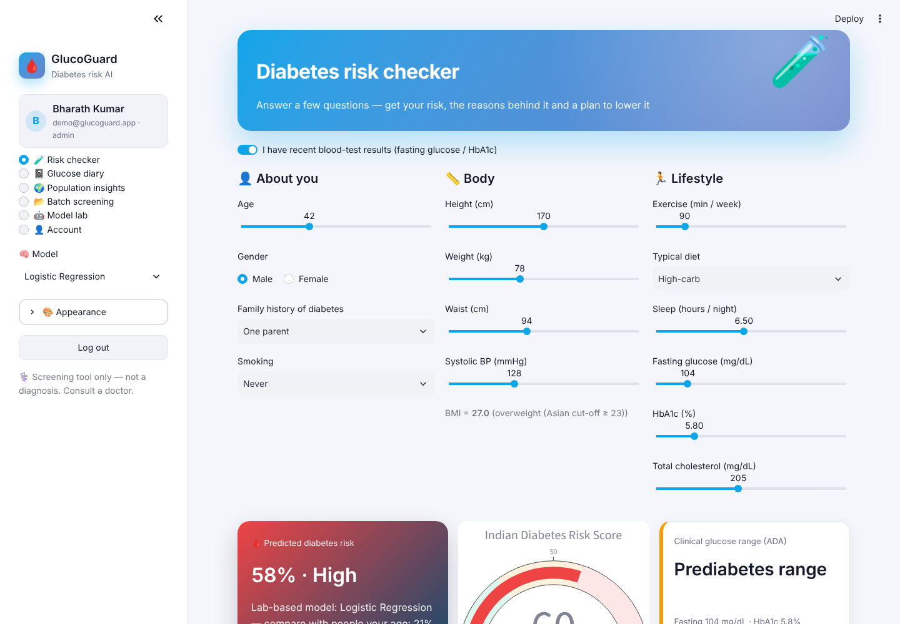
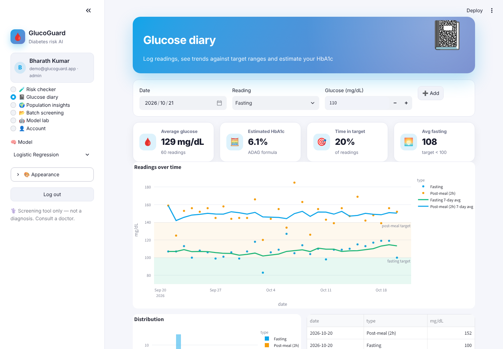
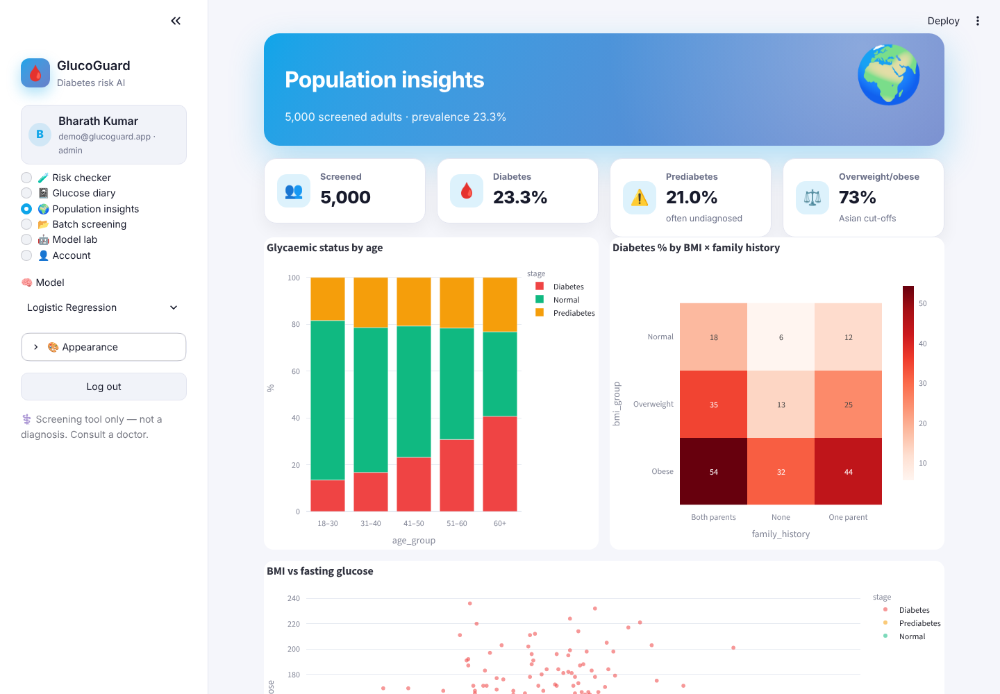
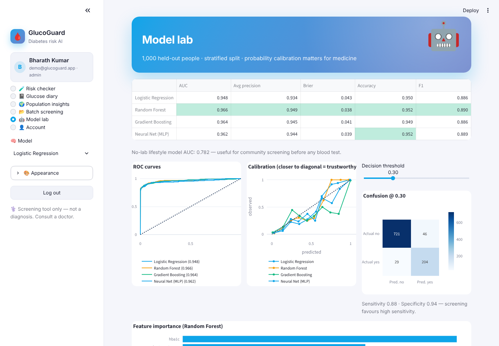

<div align="center">

# 🩸 GlucoGuard — Diabetes Risk AI

**Machine-learning diabetes risk screening (with or without lab reports), the Indian Diabetes Risk Score, explainable predictions, what-if lifestyle coaching, a glucose diary and community batch screening**


</div>

## ✨ Features

| Page | What it does |
|---|---|
| 🔐 **Register / login** | SQLite users with salted **PBKDF2-SHA256** hashing, password-strength meter, roles, demo account, change password |
| 🧪 **Risk checker** | 13 inputs (age, family history, BMI from height/weight, waist, BP, exercise, diet, sleep, smoking, glucose, HbA1c, cholesterol) → risk %, Low / Moderate / High band, **IDRS gauge**, ADA glucose range, **explanation chart**, personalised plan, **what-if** (lose weight, exercise more, change diet) and saved check history |
| 🧫 **No-lab mode** | A separate lifestyle-only model for people without blood tests — ideal for community camps |
| 📓 **Glucose diary** | Log fasting / post-meal / random readings, target bands, 7-day rolling averages, time-in-range, **estimated HbA1c** (ADAG formula), CSV export |
| 🌍 **Population insights** | Prevalence by age, BMI × family-history heatmap, BMI vs fasting-glucose scatter, exercise & diet effects |
| 📂 **Batch screening** | Upload a camp list → risk, band and IDRS for everyone, sorted for follow-up |
| 🤖 **Model lab** | Logistic Regression, Random Forest, Gradient Boosting and an **MLP neural net** — AUC, average precision, **Brier score**, ROC curves, **calibration curves**, threshold slider with sensitivity / specificity, feature importance |
| 🎨 **Themes** | Light · Dark · Midnight · Sepia · Forest, 6 accents, animation toggle |

## 🧠 How it works

* **Cohort** – 5,000 simulated adults where diabetes depends (through a logistic latent risk) on age, BMI, waist, family history, diet, activity, smoking and sleep; glucose, HbA1c, BP and cholesterol are then drawn conditionally — so models must learn realistic, overlapping signals (~23 % prevalence, ~21 % prediabetes).
* **Models** – each is a `Pipeline(ColumnTransformer(StandardScaler + OneHotEncoder) → classifier)`, evaluated on a stratified 20 % hold-out (AUC ≈ 0.95–0.97; no-lab model ≈ 0.78).
* **Explanations** – logistic-regression coefficient × standardised value, aggregated back to readable factors.
* **IDRS** – Madras Diabetes Research Foundation score from age, waist, physical activity and family history.

## 🖼️ Screenshots

| Risk checker | Glucose diary |
|---|---|
|  |  |
| **Population insights** | **Model lab** |
|  |  |

## 🚀 Run it

```bash
git clone https://github.com/PreciousBharath/GLUCOGUARD-DIABETES-RISK-AI.git
cd GLUCOGUARD-DIABETES-RISK-AI
pip install -r requirements.txt
streamlit run app.py
```

Click **⚡ Demo account** (`demo@glucoguard.app` / `Demo@1234`) or register.

## 📁 Project structure

```
app.py      # Streamlit UI — 6 pages
model.py    # cohort simulation, 4 classifiers + no-lab model, calibration, IDRS, explanations, plans
auth.py     # SQLite users + PBKDF2 hashing + login/register UI
theme.py    # 5 themes, accents, animated CSS, Plotly template
ui.py       # hero, KPI and result-card components
```

> ⚕️ Educational screening tool — not a medical diagnosis. Always consult a qualified doctor.

## 📄 License

MIT © Bharath
